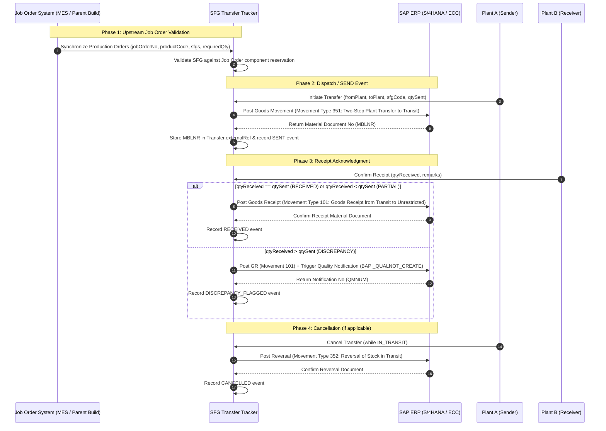

# SFG Transfer Tracker — ERP / SAP Integration Architecture

This document describes the architectural interface between the Upstream Parent Job Order System, the SFG Transfer Tracker prototype, and the future enterprise SAP ERP environment (S/4HANA or ECC).

---

## 1. End-to-End Information Flow

---

## 2. Field & Event Mapping

| Transfer Tracker Field / Event | Direction | Target SAP Field / Object | Purpose & Description |
|---|---|---|---|
| `jobOrderNo` | Inbound | `AFKO-AUFNR` (Production Order) | Identifies the parent finished good build order. |
| `sfgCode` | Inbound | `RESB-MATNR` (Material Number) | Validates child SFG against order reservation components. |
| `fromPlantId` / `toPlantId` | Outbound | `MSEG-WERKS` / `MSEG-UMWRK` | Supplying plant and receiving plant (`WERKS`). |
| **`externalRef`** | **Bidirectional** | **`MKPF-MBLNR` / `VBAK-VBELN`** | **Stores the SAP Material Document Number (e.g. `MBLNR-4900012345`) or Stock Transport Order (STO) Delivery Number generated during dispatch.** |
| Event: `SENT` | Outbound | Movement Type `351` / `BAPI_GOODSMVT_CREATE` | Moves stock from supplying plant unrestricted to transit. |
| Event: `RECEIVED` | Outbound | Movement Type `101` / `BAPI_GOODSMVT_CREATE` | Moves stock from transit into receiving plant unrestricted inventory. |
| Event: `DISCREPANCY_FLAGGED`| Outbound | Quality Notification (`QM01` / `BAPI_QUALNOT_CREATE`)| Triggers automated discrepancy audit and physical lot inspection. |
| Event: `CANCELLED` | Outbound | Movement Type `352` / `BAPI_GOODSMVT_CANCEL` | Reverses transit stock back to supplying plant inventory. |

---

## 3. Storage of Enterprise External References

The `Transfer` schema explicitly provides an `externalRef` field:
- **During Dispatch**: When SAP processes Movement Type 351, it returns a 10-digit material document number (`MBLNR`) and fiscal year (`MJAHR`). The Transfer Tracker persists this directly in `Transfer.externalRef` (e.g., `MBLNR:5000129841/2026`).
- **During Audit / Traceability**: Destination plants and auditors can query both the SFG Transfer Tracker history and the SAP document flow bi-directionally using `externalRef`.
